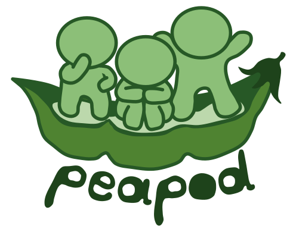

<p align="center"></p>

# CHI Peapod

Find the people at ACM CHI 2027 (Pittsburgh, May 10–14) whose work is closest to yours. Every author and session chair in the official programme gets a dot on a map built from their titles and abstracts. The map helps you to find yourself, see your nearest neighbours, and save programme items. 
This is an entry for the CHI Digital Experience competition, adapted from HFE Peapod, that was piloted in the Human Factors & Ergonomics Society (HFES) ASPIRE 2026 conference, Oct 19-25, 2026.

Data comes from the public CHI programme feed (https://chidigitalexperience.org/programme-data/, CC BY-NC-SA 4.0). The app downloads and rebuilds the data and embedding.

The live demo currently runs on the **CHI 2026** programme (https://chidigitalexperience.org/data/chi2026/latest.json), because the CHI 2027 feed (`/data/chi2027/`) is not published yet. The server re-checks the feed every 15 minutes and will switch to CHI 2027 once that feed is live, by changing one setting (`HFES_FEED_EDITION=chi2027`) and running a full rebuild.

To view a live demo of the CHI application, please visit: https://d152a4pgizvo84.cloudfront.net

For a detailed information how peapod was made, the design decisions behind it, how we are handling errors in general, and how people were using it, please visit: https://vianneyrenata.com/peapod

This submission is extensively developed with Anthropic's Claude on the coding side. However, the insights, design decisions and the peapod logo are original.

## Run it locally

Needs Python 3.12+, PostgreSQL, and ~3 GB of RAM for the first build (sentence-transformers + UMAP
over ~10k people).

```bash
python3 -m venv .venv && . .venv/bin/activate && pip install -r requirements.txt
createdb chipeapod

# Starts the API. The first start creates the tables, pulls the programme feed, writes
# authors.csv / program.csv, and runs the first embedding + map build. About a minute.
HFES_DATABASE_URL=dbname=chipeapod python3 server.py --port 8000

# In another terminal: serves the page and forwards /api to :8000, standing in for nginx.
python3 devproxy.py
```

Then open http://localhost:8765.

`HFES_FEED_EDITION` picks the feed: `chi2026` (frozen, the default while developing), `sandbox`
(synthetic, full of edge cases), or `chi2027` once it's live. `HFES_FEED_CHECK_SECONDS` is how
often the server re-checks the feed (900 = every 15 minutes; 0 = never).

To rebuild the map by hand: `HFES_DATABASE_URL=dbname=chipeapod python3 embed_umap.py full`.
`RECOMPUTE.md` is for doing that offline and copying the result to a server.

Checks: `python3 test_chi_feed.py` runs the feed converter over the sandbox's edge cases (nulls,
HTML entities, cancelled sessions, odd Unicode). `HFES_FEED_CHECK_SECONDS=0 python3 test_server.py`
is the API selftest and needs the database.

## Deploying

`deploy/` has what I use for one Ubuntu box behind CloudFront: the nginx config, two systemd units
(the API and a warm embedding worker so new sign-ups get placed in about a second), and the
bootstrap and deploy scripts. Settings live in `/etc/hfes-match.env`.

The `HFES_*` names and `hfes-match` paths are left over from the HFES version and shared with its
deploy tooling. Only what users see says CHI.

`CLAUDE.md` explains how the pieces fit together. `CHECKLIST.md` is what's still open.

## How this was made

The code was written with Anthropic's Claude (Claude Code), with me directing, reviewing and
testing every change — fully AI-assisted coding, in other words. The idea, the overall design and
architecture, the interaction flow, and the peapod mascot and logo (`img-asset/`) are my own
original work. If you find something wrong, the person to blame is me, not the model.

## Licence

The code is MIT licensed (see `LICENSE`). The programme data stays under CHI's CC BY-NC-SA 4.0 terms and is not part of this repository. The peapod mascot and logo in `img-asset/` are my own work; please ask before reusing them.

If you run Peapod at your conference, I'd love to hear about it.
